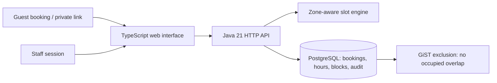

# Architecture and API

The Java process serves static assets and JSON from one origin. JDBC statements are parameterized. Virtual request threads share a bounded semaphore of sixteen database transactions; no external connection pool is required for this small MVP. Each transaction has its own connection with connect/socket timeouts. The application database role cannot delete bookings or modify/delete event and request-key records. This is an application audit trail, not tamper-proof evidence against a database administrator.

## Reservation invariant

A provider is occupied from appointment start through appointment end plus its after-session buffer. PostgreSQL’s partial exclusion constraint rejects overlapping `tstzrange` values for the same provider while `status <> 'cancelled'`. Completed and no-show appointments retain their buffers. A cancellation releases the interval while retaining the booking and history.

The API locks the provider row before changing reservations, blocks or availability. That serializes these decisions within a provider, while providers can progress independently. An exclusion constraint also protects against a direct conflicting booking insert. Direct SQL writes can bypass application validation of hours and private blocks; database access is not exposed to guests.

Create and reschedule acquire a transaction-scoped advisory lock for the request UUID before provider locks. The request-key record, mutation and audit event commit together. The request hash binds the key to normalized input and operation. Reschedule failures roll back without surrendering the old slot. Replays return the current booking state.

## Time policy

Weekly and override hours are local to the provider. A date override replaces that weekday’s hours. Closed days have no slots. Bookings use absolute UTC instants; guest zones affect display only. Slot candidates occur every fifteen local minutes. Spring gaps have no candidate; autumn folds produce both valid offsets. Opening in a fold uses its earliest occurrence, closing its latest. Boundaries inside a spring gap make a recurring day unavailable and are rejected for explicit date overrides/blocks.

A candidate’s elapsed duration plus buffer must fit before closing and avoid every occupied interval/block. The service minimum notice and inclusive local-date horizon also apply. Schedule edits preserve existing reservations and therefore may produce appointments outside subsequently edited hours.

## Private access

The create response contains a booking-specific HMAC management token. The database stores its SHA-256 hash. Browser management links put credentials in a URL fragment, and requests send them through `X-Booking-Token`. Tokens are never sent as query parameters. Public responses never contain the management hash. Anyone holding the private link can read the booking and change it before the cutoff.

Staff login issues a signed twelve-hour HttpOnly SameSite=Strict cookie. Staff mutation requests require `X-Slotline-Request: 1`; Origin, when present, must match Host. A bearer admin token supports local scripts. Logout clears the cookie; it does not revoke previously copied signed cookies before expiry. Change the admin token to invalidate all sessions. HTTPS deployments must enable secure cookies.

## Routes

All JSON writes use `Content-Type: application/json`. IDs are UUIDs; times use absolute ISO timestamps. Errors contain `error` and `code` with 401/403/404/409/422/503 status as applicable.

| Method / route | Purpose |
| --- | --- |
| `GET /api/public/catalogue` | Public providers, services and supported zones |
| `GET /api/public/slots?provider_id=&service_id=&date=` | Provider-local date availability |
| `POST /api/public/bookings` | Create with `request_id`, `provider_id`, `service_id`, `starts_at`, `guest_name`, `guest_email`, `guest_zone`, optional `note` |
| `GET /api/public/bookings/{id}` | Token-protected booking and history |
| `GET /api/public/bookings/{id}/slots?date=` | Reschedule slots excluding this reservation |
| `POST .../{id}/reschedule` | `request_id`, `starts_at`, `guest_zone` |
| `POST .../{id}/cancel` | Optional `reason` |
| `GET .../{id}/calendar.ics` | Token-protected RFC 5545 event |
| `POST /api/admin/login`, `/logout` | Staff session |
| `GET /api/admin/calendar?from=&to=&provider_id=` | Private reservations and blocks; maximum 32-day range |
| `/api/admin/bookings/{id}[/{action}]` | Staff variants of booking operations |
| `POST /api/admin/bookings/{id}/status` | `completed` or `no_show`, only after appointment end |
| `GET /api/admin/providers/{id}` | Hours, upcoming overrides and blocks |
| `PUT .../{id}/hours` | `hours: [{dow: 1..7, opens: "09:00", closes: "17:00"}]`; omitted weekdays closed |
| `POST .../{id}/overrides` | `date`, `closed`; `opens`/`closes` when open |
| `DELETE .../{id}/overrides?date=` | Remove exception |
| `POST .../{id}/blocks` | `date`, `opens`, `closes`, private `label` |
| `DELETE /api/admin/blocks/{id}` | Remove private block |
| `GET /healthz`, `/readyz` | Process health and database readiness |

Sources for implementation decisions: [PostgreSQL range exclusion constraints](https://www.postgresql.org/docs/16/rangetypes.html) and [Java ZoneRules valid offsets](https://docs.oracle.com/en/java/javase/21/docs/api/java.base/java/time/zone/ZoneRules.html#getValidOffsets(java.time.LocalDateTime)).
